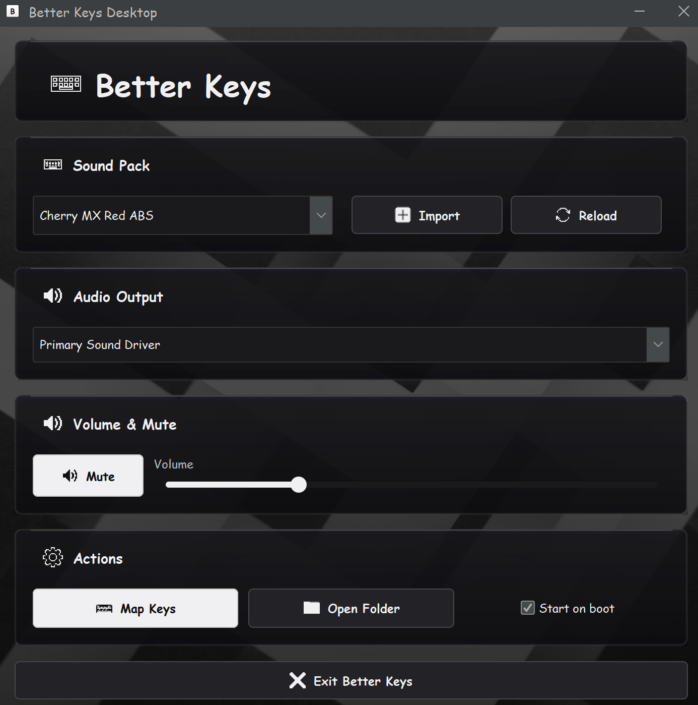
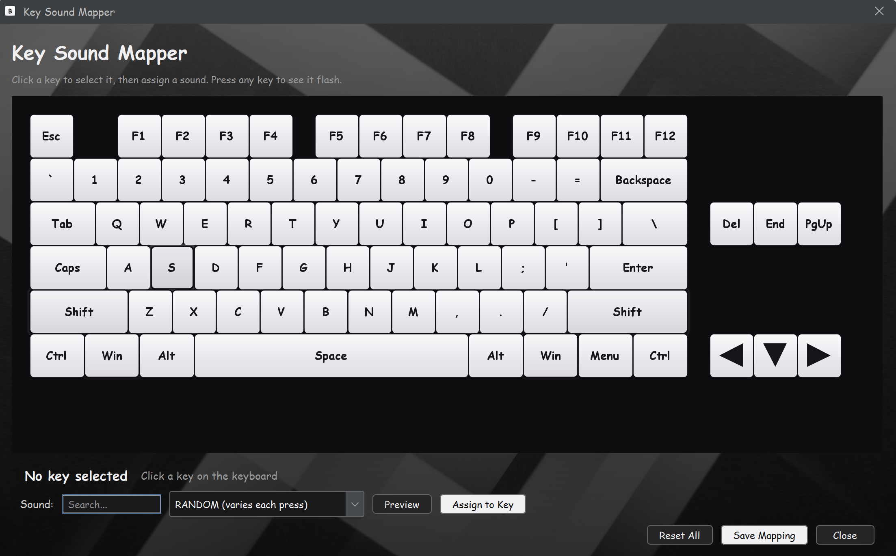
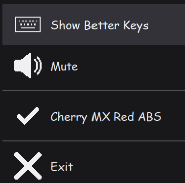

# Better Keys

Better Keys is a lightweight desktop app for Windows that plays mechanical keyboard switch sounds for every keypress and mouse click, system wide. It runs quietly in the system tray, works in any app or game, and lets you swap between soundpacks, pick your audio output, and adjust the volume from a clean tray menu.

## Screenshots

Captures of the app in use: the main window where you pick a soundpack and volume, the sound mapper where each key gets its own sound, and the tray menu that is always one click away.

**Main window**



**Key Sound Mapper**



**Tray menu**



## Features

- Global key and mouse sound feedback based on real mechanical switch samples
- Soundpack system: import your own packs or edit mappings per key
- System tray menu for quick access: show, mute, soundpack switch, exit
- Choose a specific audio output device or stay on the system default
- Start on boot, with your selected soundpack restored automatically
- Debounced input so holding or spamming a key plays the sound once

## How it works

For the full technical breakdown of the input hooks, sound engine, soundpacks, config, and packaging, see [ARCHITECTURE.md](ARCHITECTURE.md).

## Install

1. Download `BetterKeys.zip` from the releases page and unzip it.
2. Run `BetterKeys Setup.exe` and pick an install folder.
3. That is it. Search for "Better Keys" in the Windows Start menu to launch it any time.

After the first launch the app lives in the system tray and the startup entry is managed from the Settings window.

## Download soundpacks

Extra soundpacks are just folders of WAV files plus a `pack.json`. Put them here:

```
%USERPROFILE%\.betterkeys\soundpacks\<Pack Name>\
```

Use the "Open Folder" button in the app to jump straight there. A `Cherry MX Red ABS` pack ships with the app.

## Build from source

Requirements: JDK 17 and Maven.

```
mvn package
```

The runnable jar lands in `target/betterkeys-desktop-1.0.0.jar`. To produce a Windows app image:

```
jpackage --type app-image --input target --main-jar betterkeys-desktop-1.0.0.jar --name BetterKeys --icon src/main/resources/icon.ico
```

Run the jar directly for development (no packaging needed):

```
java -jar target/betterkeys-desktop-1.0.0.jar
```

## Project structure

```
src/main/java/com/justsamyog/betterkeys/
    Main.java            entry point
    audio/               sound engine and WAV synthesis
    config/              app config persistence
    model/               soundpacks and pack management
    input/               global keyboard and mouse hook
    ui/                  tray, main window, dialogs, icons
```

## Credits

- [JNativeHook](https://github.com/kwhat/jnativehook) for the global input hooks
- [FlatLaf](https://www.formdev.com/flatlaf/) for the dark look and feel

## License

Custom license, see [LICENSE](LICENSE). Short version: use it and modify it freely, but credit JustSamyog as the original author. Rebranding it or claiming it as your own work is not allowed.
